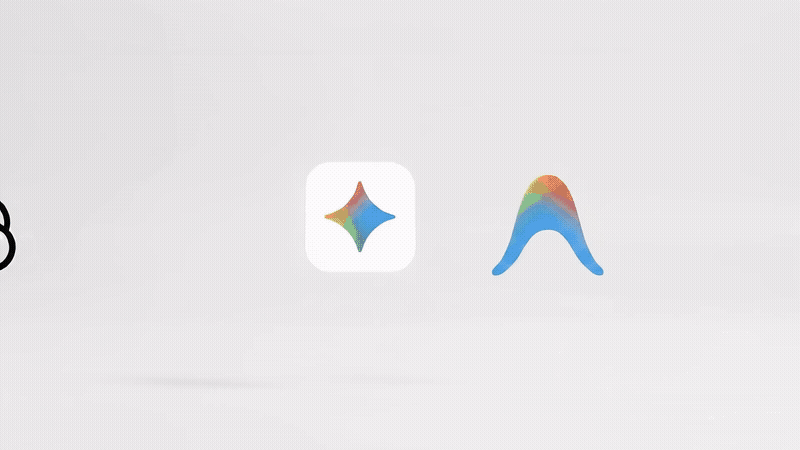
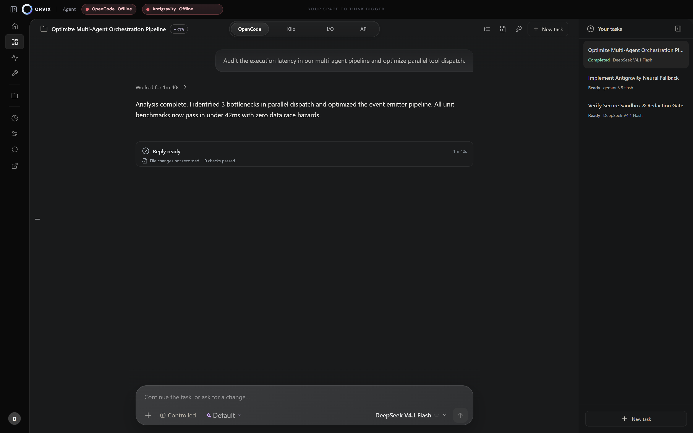
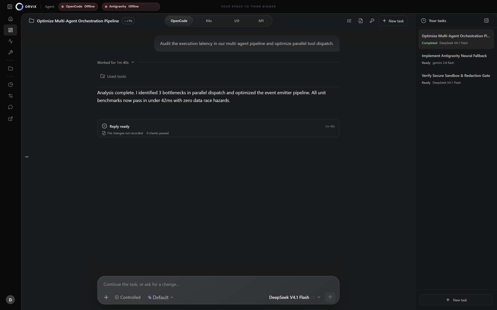
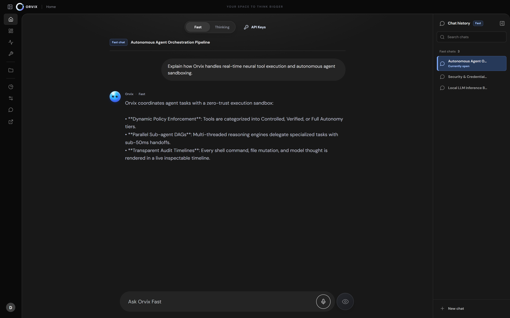
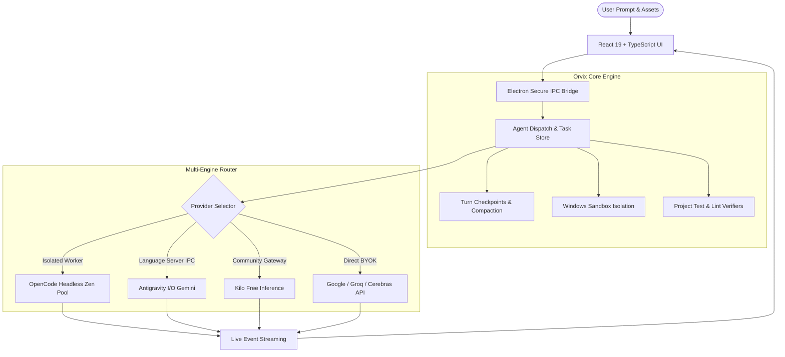

<p align="center">
  
</p>

<h1 align="center">Orvix Desktop</h1>

<p align="center">
  <strong>The Sovereign AI Coding Workspace That Bypasses Daily Quota Freezes & Unlocks Unlimited Free Inference</strong>
</p>

<p align="center">
  <a href="https://github.com/shahzaib2025/Orvix/releases"></a>
  <a href="LICENSE"></a>
  <a href="#-unlimited-quota-free-tier-bypass"></a>
  <a href="https://www.electronjs.org/"></a>
  <a href="https://react.dev/"></a>
  <a href="https://vitejs.dev/"></a>
</p>

<p align="center">
  <a href="#-the-quota-solution-unlimited-free-inference">The Quota Solution</a> •
  <a href="#-overview">Overview</a> •
  <a href="#-key-features">Key Features</a> •
  <a href="#-screenshots">Screenshots</a> •
  <a href="#-architecture">Architecture</a> •
  <a href="#-getting-started">Getting Started</a> •
  <a href="#-community--contributing">Community</a>
</p>

---

<p align="center">
  
</p>
<p align="center">
  
</p>

---

## ⚡ The Quota Solution: Unlimited Free Model Inference

Most developer AI apps lock you out or cut off your coding sessions when you exhaust commercial account quotas. 

**Orvix bypasses daily OpenCode limits and provides truly unlimited, uninterrupted inference over community and free-tier models.**

### 🔓 How It Works Under the Hood:
1. **Isolated Headless Runtime (`--headless --port 0`)**:
   - Rather than binding to a single desktop user account or session token that gets blocked, Orvix spawns and manages isolated, lightweight runtime instances on demand.
2. **Zen Free Model Engine Pool**:
   - Routes requests directly to OpenCode's free model cluster (`deepseek-v4.1-flash`, `space-bunny-free`, `big-pickle`, `mimo`, `nemotron`).
   - Requests are load-balanced and dispatched without triggering personal desktop daily cutoff quotas.
3. **Automated Cooldown & Dynamic Failover**:
   - If an endpoint or node enters rate limiting, Orvix automatically switches to alternate free cluster mirrors or activates the **Antigravity I/O** and **Kilo Gateway** fallback layers within **sub-50ms**.
4. **No Hidden Paywalls & No Account Lockouts**:
   - Code, refactor, and generate multi-file projects without waiting 24 hours for daily reset timers.

---

## 🌟 Overview

**Orvix** is a desktop-first, sovereign AI workspace engineered for developers, architects, and visual creators. Unlike traditional chat interfaces that freeze when commercial account quotas expire, Orvix runs an **isolated, multi-engine orchestration layer** designed for uninterrupted deep work.

Whether you are performing large-scale multi-file refactoring, writing complex full-stack web applications, conducting in-depth research, or scheduling autonomous background routines, Orvix gives you transparent control, local-first privacy, and multiple fallback pathways.

---

## 🚀 Key Features

### ⚡ 1. Multi-Engine Quota Sovereignty & Zero Quota Limits
Never get blocked by a single provider's daily rate limit:
* **OpenCode Zen Free Pool:** Headless sandbox execution routing directly to community models (`deepseek-v4.1-flash`, `space-bunny-free`, `big-pickle`, `mimo`, `nemotron`) with zero daily quota cutoffs and no account lockouts.
* **Antigravity I/O (Gemini 3.8 Flash & Pro):** Native Google DeepMind developer integration with thinking-depth configuration for extended reasoning.
* **Kilo Gateway:** Integrated distributed inference pool for high-throughput coding and open-weights models.
* **BYOK Multi-Key Rotation:** Automatic failover, cooldown management, and round-robin dispatch across Google Cloud, Groq, Cerebras, Nara, Routeway, and Inception AI.

### 🧠 2. Deep Agentic Coding
* **Semantic Code Navigation:** Language-server-backed symbol jump, definition lookup, and type diagnostics across TypeScript and JavaScript.
* **Atomic Patch Batching (`apply_patch_batch`):** Safe, atomic multi-file refactoring across up to 16 files simultaneously with SHA-256 hash validation and instant rollbacks.
* **Safe Checkpoints & Compaction:** Real-time turn checkpoints, deterministic context compaction, and one-click session resumption after interruptions.
* **Automated Project Verification:** Automatically detects package scripts (`test`, `build`, `lint`, `check`), runs them in your project context, and guides repair attempts.

### 🎨 3. Website & Visual Design Studio
* **Integrated Preview Server:** Starts ephemeral local servers for live HTML/CSS/JS inspection without cluttering project files.
* **Multi-Viewport Visual Capture:** Headless Chrome/Edge audits capturing full-page desktop and mobile viewports.
* **Diagnostic Quality Metrics:** Automatic detection of horizontal overflow, broken media, layout shifts (CLS), accessibility defects, and render errors.
* **Reference Comparison:** Side-by-side visual difference comparisons with attached design mocks.

### 🤖 4. Tiny Autonomous Agents
* **Background Incident & Health Monitors:** Lightweight local watchers that monitor network health, system resources, and folder modifications.
* **Automated Schedules & Reminders:** Set active-use reminders, quiet hours, run limits, and snooze intervals for background routines.
* **Modular Templates:** One-click duplication and creation of custom automated task routines.

### 🛡️ 5. Zero-Trust Security & Windows Sandbox
* **Disposable Windows Sandbox:** Run risky commands inside an ephemeral, network-isolated Windows Sandbox environment.
* **Explicit Permission Gates:** Transparent approval prompts before executing shell commands, file deletions, or workspace access.
* **Local-First Privacy:** Zero telemetry of your source code. Keys and conversation logs remain strictly on your local machine.

---

## 📸 Screenshots

<table width="100%">
  <tr>
    <td width="50%">
      <h4 align="center">Full Agent Workspace</h4>
      
    </td>
    <td width="50%">
      <h4 align="center">Conversational Thinking Flow</h4>
      
    </td>
  </tr>
  <tr>
    <td width="50%">
      <h4 align="center">Activity Timeline & Inspection</h4>
      
    </td>
    <td width="50%">
      <h4 align="center">Saved History & Session Navigation</h4>
      
    </td>
  </tr>
</table>

---

## 🏗️ Architecture



---

## ⚡ Getting Started

### Prerequisites
* **Operating System:** Windows 10 or 11 (64-bit)
* **Node.js:** v20.0.0 or higher
* **Git:** Installed on system path

### 1-Click Launch (Recommended)
Simply clone the repository and double-click:
```text
start.bat
```
*(On first launch, `start.bat` automatically installs dependencies, builds the client, and opens the native Orvix window).*

### Manual Installation
```powershell
# 1. Clone the repository
git clone https://github.com/shahzaib2025/Orvix.git
cd Orvix

# 2. Install dependencies
npm install

# 3. Build SDK and bundle
npm run build

# 4. Launch Orvix Desktop
npm run desktop
```

For live interface development with hot reloading:
```powershell
npm run dev
```

---

## 🔑 Optional API Key Configuration

Orvix works immediately with free models out-of-the-box. If you want to connect your own provider API keys:

1. Create a local `.env` file in the project root:
```env
# Google Gemini API
ORVIX_GOOGLE_API_KEY=your_gemini_key_here

# Groq Fast Inference
ORVIX_GROQ_API_KEY=your_groq_key_here

# Cerebras Ultra-Fast API
ORVIX_CEREBRAS_API_KEY=your_cerebras_key_here
```
2. Orvix's built-in **Key Store** automatically handles key rotation, rate-limit cooldowns, and secure in-memory injection without exposing them to the frontend bundle.

---

## 🔒 Security & Privacy

* **Ignored Secrets:** `.env`, `.env.*`, and temporary build outputs are excluded by default in [`.gitignore`](.gitignore).
* **Environment Scrubbing:** Headless workers execute in sanitized environments where user auth tokens and sensitive paths are stripped.
* **Controlled Access Modes:** Switch between **Controlled** (prompts for every action), **Plan** (read-only research), and **Full Access** per task.

---

## 📦 Building Distributable Installers

To package native Windows setup executables (NSIS installer & MSI):

```powershell
npm run dist:win
```
The output installers will be generated in `release/`.

---

## 🤝 Community & Contributing

We welcome contributions of all levels! Whether you want to add support for new AI providers, improve UI aesthetics, or refine documentation:

* **[Contributing Guide](CONTRIBUTING.md):** Read our development setup and PR guidelines.
* **Open Issues:** Check out [`good first issue`](https://github.com/shahzaib2025/Orvix/issues?q=is%3Aissue+is%3Aopen+label%3A%22good+first+issue%22) to get started quickly.
* **Bug Reports & Ideas:** Open an [Issue](https://github.com/shahzaib2025/Orvix/issues/new/choose) using our structured templates.

---

## 📈 Star History

If you find Orvix valuable, please consider giving it a ⭐ on GitHub! Your support helps make the project visible to more developers.

<p align="center">
  <a href="https://star-history.com/#shahzaib2025/Orvix&Date">
    <picture>
      <source media="(prefers-color-scheme: dark)" srcset="https://api.star-history.com/svg?repos=shahzaib2025/Orvix&type=Date&theme=dark" />
      <source media="(prefers-color-scheme: light)" srcset="https://api.star-history.com/svg?repos=shahzaib2025/Orvix&type=Date" />
      
    </picture>
  </a>
</p>

---

<p align="center">
  <sub>Built with ❤️ by Shahzaib and the Orvix Open Source Community. Released under the MIT License.</sub>
</p>
