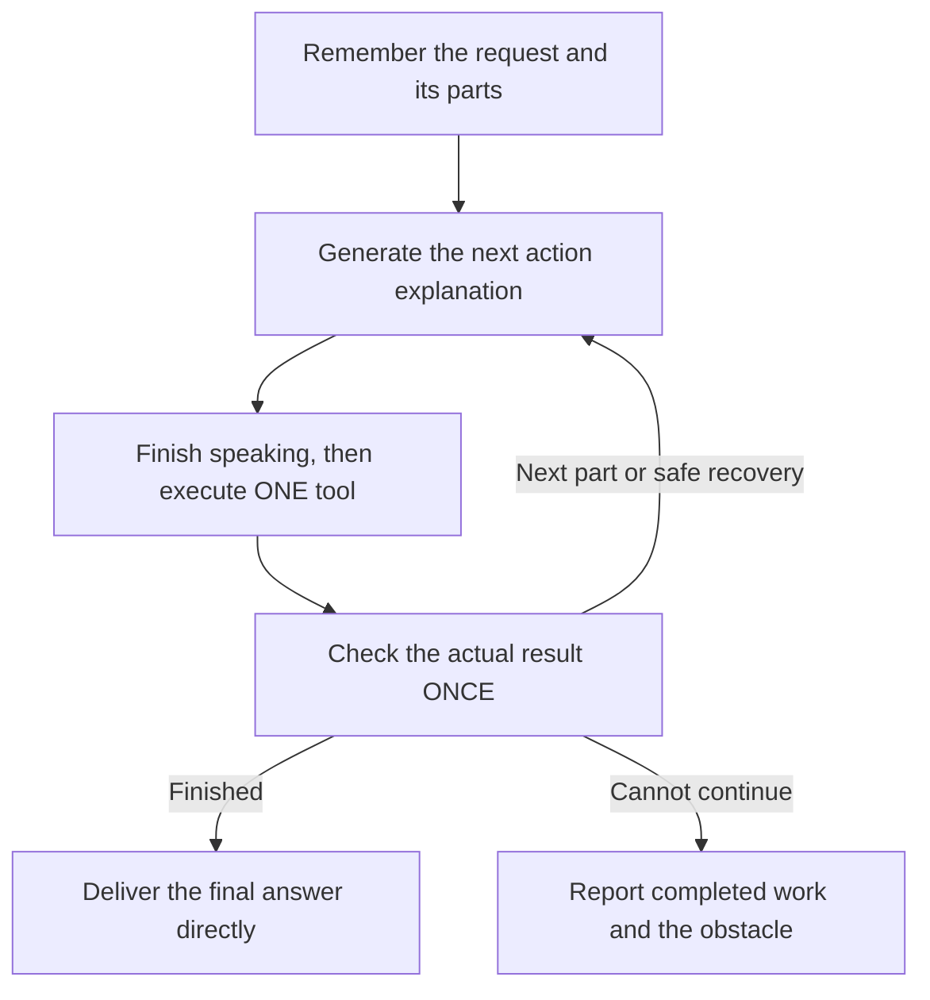

# Fast: one work loop

Fast uses the same work cycle for research, files and PC tasks:

Ordinary chat still goes directly to a reply. There is no separate final-answer review, planning tool, worker delegation or parallel work mode. The model keeps the requested parts in view and chooses the next action from the actual result. This is sequential multi-step execution.

## What changed

- Every executed operation returns its result before another action is chosen. If Gemini proposes a batch, only its first operation executes. The other IDs receive `deferred`, `dispatched: false` responses. Gemini must reconsider them and issue a fresh single call; their stale arguments are not executed automatically.
- Results carry a small `workProgress` summary: the original request, actual completed/unfinished steps, pending approvals, uncertain effects, remaining named sources and exhausted catalog reads. This reuses existing receipts, without introducing a requirement ledger or another model reviewer.
- Current Google/OpenAI catalog reads use this same loop. A clear typed request can start its known first read after the opening explanation, without an initial main-model draft. Each result is returned immediately. The former gather-all-catalogs branch and extra catalog-summary generation are gone.
- An opening explanation can cover its exact first page read. Later operations each receive fresh generated wording. Uncertain effects and pending approvals are distinguished from failures in progress context.
- Failed searches now receive a recovery/obstacle instruction instead of being described as usable search leads. Exhausted catalog retries remain visible as obstacles, without instructions to repeat those reads.
- Bangla `বর্তমান` and `সাম্প্রতিক` model requests recognize the same known-source path as English current/latest requests.

The single controller result check classifies an executor result; domain executors retain their existing observed-target/postcondition checks and approvals. It does not independently prove every factual claim or completion of the full request. Final-answer accuracy and coverage still depend on Gemini using the supplied evidence.

Speech drains before tool execution, approved actions and queued requests. Duplicate IDs reuse receipts; unknown mutations are not replayed. Existing tool limits and one connection recovery remain. A speech-generation failure prevents the unannounced action and produces an obstacle report. Final audio buffering remains unchanged; instant acknowledgment or physical audio performance is not guaranteed.

## Validation

The deterministic suite adds dependent find/read/write execution, first-read startup, failure-to-alternative continuity, batch deferral, proposals arriving during execution, duplicate/deferred IDs, one result check per execution, retained progress through reconnects and exhausted source recovery. The real Web Audio fixture now re-proposes its second action after receiving the first result.

Commands and outputs:

- `npm run check:fast-reliability` — 328 tests plus browser/audio fixtures passed; `scratch/fast-work-loop-reliability.log`.
- `npm run build` — TypeScript and Vite passed, with the existing large-chunk warning; `scratch/fast-work-loop-build.log`.
- `node scripts/check_simple_fast_live.cjs --work-loop` — `scratch/simple-fast-work-loop-live.report.json` and `scratch/fast-work-loop-live.log`.

The final live rerun completed all four typed turns: ordinary English chat, a Bangla model comparison, an English comparison with explicit page reads, and a Bangla follow-up using retained results. Every loop audit passed: no overlapping tools, explanations completed before dispatch, one controller result check per operation, both comparison sources retrieved, no follow-up re-search, and final PCM returned. Operations per turn were 0/2/2/0. First progress PCM on the three work turns started at 1.306/2.420/0.784 seconds; full turns took 39.547/44.587/19.196 seconds. PCM is counted, not played in this harness.

Manual excerpt inspection supported the named models' intended-use statements in the comparisons. The Bangla comparison also added a general knowledge-cutoff caveat that was not established by the retrieved excerpts. These passing execution audits are not proof that every final claim or requested dimension was satisfied. No final-answer verifier was reintroduced.

The live harness uses real Gemini Live, public source retrieval, typed English/Bangla requests and counted PCM. It does not validate physical microphone capture, audible speaker playback or the packaged Windows app. The initial live attempt is preserved in `scratch/simple-fast-work-loop-live.initial.report.json`: one acknowledgment startup timeout prevented its page read, and the obstacle report used visible delivery. Its successful later comparison/follow-up do not turn that failed request into a pass.

Provider protocol references: [Google function calling](https://ai.google.dev/gemini-api/docs/function-calling), [Live tool responses and blocking behavior](https://ai.google.dev/gemini-api/docs/live-api/tools).
