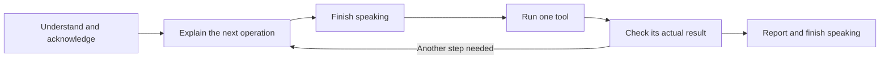

# Simple Fast profile

Current work execution: [one repeating work loop](fast-single-work-loop-2026-10-06.md).

Current final-answer behavior: [direct delivery without an answer-verification gate](fast-direct-answer-delivery-2026-10-06.md).
The original implementation snapshot below predates this update.

Fast now uses `SimpleFastVoiceSession` through the normal voice facade. The previous voice planner, automatic research gathering, worker escalation, and independent completion-review loop are outside this active path. Their shared modules remain for compatibility and other features.

One queue owns progress speech, tool execution, approved PC actions, final speech, and subsequent typed requests. Audio completion uses actual playback drain or the installed voice's `onend`, rather than a timer that cancels speech. Main-model output is buffered until complete, so a tool proposal cannot cut off a half-spoken draft. Gemini uses `NO_INTERRUPTION`; microphone PCM is forwarded while idle and withheld during responses and work. The Stop button remains an explicit interruption.

Every task receives an immediate visible acknowledgment and a spoken acknowledgment when rendering is available. Every dispatched tool receives a meaningful explanation first. Google/OpenAI searches, page reading, typing, Enter, window operations, and recovery explanations describe the actual operation. Input text, private paths, and model-authored success labels are not read as progress acknowledgments.

PC actions retain the existing approval dialogs, settings, observed-reference checks, execution queue, and outcome verification. Accepting a dialog queues its exact approved action for a fresh explanation and execution through the voice queue. Speech cannot grant approval. A new user task cancels an older pending PC task; verified effects are never undone by that cancellation.

Checks cover the actual tool result. Search leads alone cannot support a factual report. Current-model research requires original publisher pages; a failed search can be followed by a separately announced read of the known official catalog. Explicit page-reading requests require current-turn retrievals of every named page. English/Bangla requests to reread the previous sources carry those URLs into the next request. An uncertain effect, pending approval, failed lookup, or missing required source cannot become a success report.

Duplicate call IDs reuse retained results. Identical mutations are not replayed within a turn. A failed response send retains its result and permits one connection recovery; it does not spin or rerun the executor. The same failing operation has three attempts total. Independent operations can continue. Work stops at 60 tool operations or ten minutes and reports an incomplete request. A terminal connection failure waits for current speech to finish, retains results, reports the interruption, and releases the active approval queue.

## Verification

- 40 new controller tests passed, covering speech/tool ordering, queued requests, microphone gating, duplicate IDs and mutations, cancellation, Stop/Start races, failures, source coverage, budgets, connection failure, and PC approval dispatch.
- The combined reliability suite passed 281 tests, including 241 existing regressions. Legacy voice tests remain historical regression coverage; the new profile has its own tests and browser fixture.
- The new real Web Audio fixture passed: both PCM buffers drained before each of two tools; synthetic microphone input remained gated while busy; no automatic playback clear occurred; a subsequent request waited for final speech.
- 28 Tiny Workflow tests passed. The browser navigation/settings checks passed. TypeScript and the production build passed; Vite still reports the existing large-chunk warning.
- Three real provider turns used typed Bangla/English prompts and public Google/OpenAI catalog pages. Each turn ran two research operations. All six operations followed completed or visible acknowledgments, and measured operation concurrency stayed at one. All three final reports returned PCM. Failed search retrieval recovered through a subsequent official-page read; the comparison and reread turns each fetched both source pages.

The last live run delivered **5 of 9 progress acknowledgments as matched PCM**; **4 used the written fallback** after the speech renderer failed. The three final reports all returned audio. The Node harness has no installed operating-system voice, so it cannot validate the native fallback. These are three smoke-test turns, not the previous 50-request release benchmark or proof of perfect factual coverage.

## Speech fallback and remaining validation

The speech renderer can return incomplete or mismatched transcription. Unplayed rendering gets one retry; a mismatched candidate is rejected. Fast then tries an installed voice matching the response language, including briefly waiting for asynchronously loaded voices. Once native speech starts, the queue waits for `onend` or an error; it never cancels a sentence because a fixed playback duration elapsed. If neither renderer is available, the entire explanation stays visible and its audible delivery is marked interrupted. Work can continue without silently replaying a tool.

Physical microphone input, audible speakers, installed Windows voices, and the packaged Windows application were not verified in this pass. Restart Orvix to load the new preload/main approval bridge before using the new profile.

Relevant provider documentation: [blocking Live tools](https://ai.google.dev/gemini-api/docs/live-api/tools) and [Live activity handling](https://ai.google.dev/api/live).

Commands: `npm run check:fast-simple`, `npm run check:fast-reliability`, `npm run check:fast-simple:live`, and `npm run build`. The live test writes `scratch/simple-fast-live.report.json`; it counts PCM without playing it.
